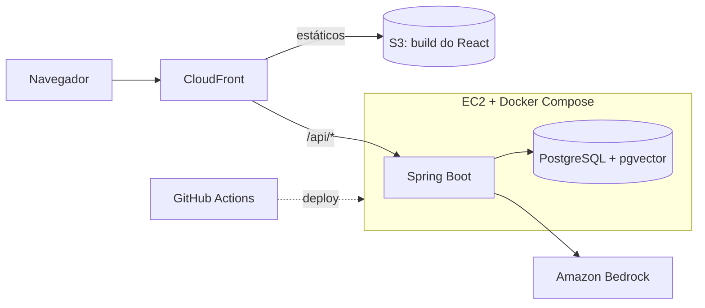

# Assistente de Pedidos com IA

Assistente de pedidos por chat. O usuário descreve o que quer comer ("almoço vegetariano, sem glúten, até R$ 40, pronto em 30 minutos") e o sistema busca opções no catálogo, explica a escolha e monta o carrinho.

> Projeto de portfólio em desenvolvimento. O catálogo é fictício e o projeto não tem vínculo com nenhuma empresa de delivery.

**Demo:** em breve

## Como funciona

O modelo de linguagem não responde de memória. Ele decide quando chamar ferramentas (tools) que o backend executa:

- `search_dishes`: busca pratos por significado, combinada com filtros de preço, restrição alimentar e tempo de preparo
- `get_dish`: detalhes de um prato
- `add_to_cart` e `view_cart`: monta e consulta o carrinho

A busca é híbrida: filtros SQL mais similaridade de cosseno com pgvector. O preço sempre vem do banco, nunca do modelo, e todos os argumentos das tools são validados no servidor.

## Stack

| Camada | Tecnologia |
|---|---|
| Front-end | React + TypeScript |
| Back-end | Java 21 + Spring Boot |
| Banco | PostgreSQL + pgvector |
| IA | Amazon Bedrock (LLM e embeddings) |
| Infra | S3 + CloudFront, EC2 com Docker Compose |
| CI/CD | GitHub Actions |

## Arquitetura



Detalhes em [docs/architecture.md](docs/architecture.md).

## Roadmap

**Fase 1 (em andamento)**
- [ ] Schema do banco e catálogo fictício com embeddings
- [ ] Busca híbrida (filtros SQL + pgvector)
- [ ] Agente com Bedrock e tools
- [ ] Chat em React com respostas em streaming
- [ ] Deploy na AWS e CI/CD
- [ ] Avaliação com 30 pedidos de teste

**Fase 2**
- [ ] Checkout
- [ ] Autenticação com Cognito

**Fase 3 (opcional)**
- [ ] Migração para ECS Fargate + RDS (ver ADR 0003)

## Estrutura do repositório

```
.
├─ backend/     # Spring Boot
├─ frontend/    # React + TypeScript
├─ eval/        # casos de teste e avaliação do assistente
├─ docs/        # arquitetura e decisões (ADRs)
└─ docker-compose.yml
```

## Rodando localmente

Pré-requisitos: Docker, Java 21 e Node.js (versão LTS).

```bash
cp .env.example .env        # defina DB_PASSWORD
docker compose up -d db     # PostgreSQL com pgvector
```

Instruções do backend e do frontend serão adicionadas conforme cada parte for construída. Para chamar o Bedrock é preciso uma conta AWS com acesso aos modelos habilitado.

## Decisões de arquitetura

Cada decisão importante tem um registro em [docs/adr](docs/adr): monólito modular, pgvector no PostgreSQL, EC2 com Docker Compose em vez de ECS + RDS, porta `LlmClient` para isolar o provedor de IA e CloudFront com duas origens.

## Resultados da avaliação

Os números abaixo serão preenchidos com medições reais, rodando a suíte de [eval/](eval).

| Métrica | Valor |
|---|---|
| Pedidos de teste | a medir |
| Taxa de acerto | a medir |
| Latência média | a medir |
| Custo médio por conversa | a medir |

## Autor

Caio Ferreira · [LinkedIn](https://www.linkedin.com/in/caio-ferreira-32b330205/) · [GitHub](https://github.com/CaioLira18)
