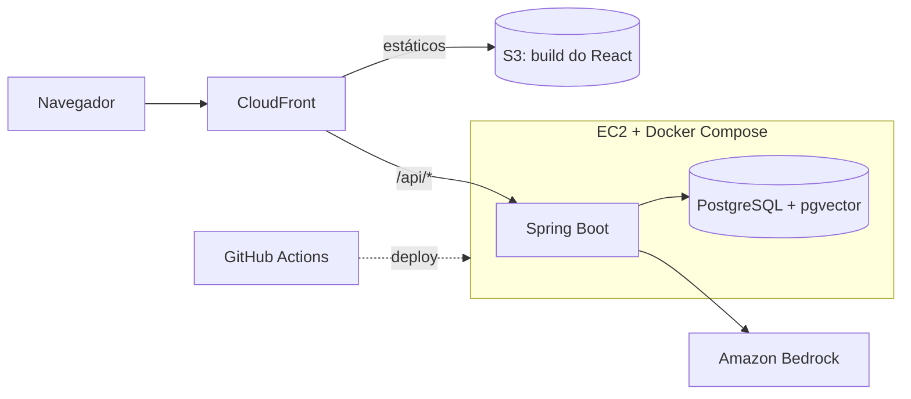

# Arquitetura

## Visão geral

## Componentes

| Componente | Responsabilidade | Tecnologia |
|---|---|---|
| Frontend | Chat com streaming, cards de pratos, carrinho | React + TypeScript |
| CloudFront | HTTPS, cache dos estáticos, roteamento `/api/*` | AWS |
| API | Catálogo, carrinho, orquestração do agente | Spring Boot |
| Banco | Dados relacionais e busca vetorial | PostgreSQL + pgvector |
| IA | Modelo de linguagem e embeddings | Amazon Bedrock |

## Fluxo do agente

1. O front envia a mensagem e recebe a resposta em streaming (SSE).
2. O `AgentOrchestrator` monta o prompt: instruções do sistema, últimas N mensagens e definição das tools.
3. Chama o Bedrock (Converse API). Se o modelo pedir uma tool, o backend valida os argumentos, executa e devolve o resultado.
4. O ciclo repete com limite de iterações e timeout.
5. A resposta final é transmitida ao front; mensagens e métricas (tokens, latência, custo) são salvas.

Tools da fase 1: `search_dishes`, `get_dish`, `add_to_cart`, `view_cart`.

## Segurança

- O modelo nunca é fonte de verdade: argumentos validados, preço lido do banco, carrinho preso à sessão.
- Textos de pratos entram no prompt como dado delimitado, não como instrução.
- Rate limit por sessão e IP, limite de tokens por resposta, teto diário de mensagens, alerta no AWS Budgets.
- Acesso ao Bedrock por IAM role da instância, sem chaves no código.
- Porta da EC2 liberada só para a prefix list do CloudFront, com validação de header secreto.

## Operação

- Deploy: GitHub Actions testa, gera a imagem e atualiza a EC2.
- Backup: `pg_dump` agendado para o S3.
- Logs em JSON com correlation id.

## Evolução prevista

ECS Fargate + RDS + ALB (ADR 0003), Cognito, checkout.
