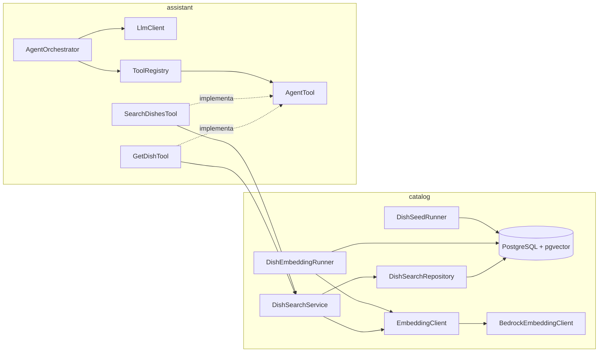

# Mapa dos arquivos Java

Guia de para que serve cada arquivo `.java` do projeto **Assistente de Pedidos com IA**, no estado atual do desenvolvimento. Pacote base: `io.github.caiolira18.foodassistant`.

## Visão geral dos pacotes

| Pacote | Papel | Branch de origem |
|---|---|---|
| (raiz) | Ponto de entrada da aplicação Spring Boot | `chore/backend-bootstrap` |
| `catalog.seed` | Gera e insere o catálogo fictício de pratos | `feat/catalog-seed-generator` |
| `catalog.embedding` | Gera embeddings (vetores) dos pratos pelo Amazon Bedrock | `feat/embedding-client` |
| `catalog.search` | Busca híbrida (filtros SQL mais similaridade vetorial) e consulta de um prato por id | `feat/catalog-hybrid-search` e `feat/agent-search-tools` |
| `assistant.llm` | Porta (interface) do modelo de linguagem e seus tipos | `feat/llm-client-port` |
| `assistant.agent` | Orquestrador do agente: loop de ferramentas, limites e registro de tools | `feat/agent-orchestrator` |
| `assistant.agent.tools` | Ferramentas do agente sobre o catálogo (`search_dishes` e `get_dish`) | `feat/agent-search-tools` |

## Como as peças se conectam

Regras de projeto que aparecem em várias classes:

- **Portas e adaptadores:** `EmbeddingClient` e `LlmClient` isolam o provedor de IA. O domínio não conhece a AWS, e os testes usam *fakes* (ADR 0004).
- **Servidor é a fonte de verdade:** argumentos de busca e de ferramentas são validados no servidor, e o preço sempre vem do banco.
- **Ferramentas validam tudo:** cada tool recusa campos desconhecidos, tipos errados e valores fora da faixa antes de tocar o catálogo, e o erro volta ao modelo como JSON. As tools atuais são só de leitura.
- **Perfis do Spring** (`seed`, `embed`, `search`) mantêm as tarefas de linha de comando fora da execução normal.

---

## Raiz

| Arquivo | Para que serve |
|---|---|
| `FoodassistantApplication.java` | Ponto de entrada da aplicação Spring Boot (`main`). Sobe o contexto, o Flyway e o servidor web. |

## `catalog.seed`: catálogo fictício

| Arquivo | Para que serve |
|---|---|
| `DishSeed.java` | *Record* com os dados de um prato gerado: nome, descrição, preço em centavos, tempo de preparo e tags alimentares. |
| `DishSeedGenerator.java` | Java puro, sem Spring. Gera de forma determinística 150 pratos (30 pratos base × 5 variações: normal, Fit, Grande, Família e Express). Garante coerência das tags: `vegano` implica `vegetariano` e `sem-lactose`. |
| `DishSeedRunner.java` | Executa só com o perfil `seed`. Insere os pratos no banco em lote com `JdbcTemplate`. É idempotente: se a tabela `dish` já tem pratos, não faz nada. Os embeddings ficam nulos nessa etapa. |

## `catalog.embedding`: vetores dos pratos

| Arquivo | Para que serve |
|---|---|
| `EmbeddingClient.java` | Porta (interface) com `float[] embed(String texto)`. A busca e o gerador dependem dela, não do Bedrock. |
| `BedrockConfig.java` | Configuração Spring que cria o `BedrockRuntimeClient`. Lê região e perfil AWS das propriedades. Sem perfil informado, usa a cadeia padrão de credenciais (a IAM role na EC2). |
| `BedrockEmbeddingClient.java` | Adaptador da porta: chama o modelo Titan Text Embeddings V2 no Bedrock (`InvokeModel`), com 1024 dimensões normalizadas, e valida a dimensão da resposta. |
| `DishEmbeddingRunner.java` | Executa só com o perfil `embed`. Para cada prato sem vetor, monta o texto (nome, descrição e restrições em linguagem natural), gera o embedding e grava no banco. É idempotente e registra o progresso a cada 25 pratos. |
| `VectorLiteral.java` | Converte um `float[]` para o formato de texto do pgvector (por exemplo `[0.5,-1.0]`), usado nos parâmetros SQL com `::vector`. |

## `catalog.search`: busca híbrida

| Arquivo | Para que serve |
|---|---|
| `DishSearchFilters.java` | *Record* com os filtros opcionais: preço máximo, tempo máximo e restrições obrigatórias. Valida no construtor (valores positivos e apenas as tags `vegano`, `vegetariano`, `sem-gluten` e `sem-lactose`). `none()` devolve "sem filtros". |
| `DishSearchResult.java` | *Record* de um resultado da busca: id, nome, descrição, preço, tempo de preparo, tags e similaridade de cosseno. |
| `DishDetails.java` | *Record* com os dados de um prato consultado por id: id, nome, descrição, preço, tempo de preparo e tags (sem similaridade). |
| `DishSearchRepository.java` | Executa uma única SQL com os filtros montados dinamicamente e ordenação por distância de cosseno (`<=>`). Todos os valores vão como parâmetros do `PreparedStatement`. Ignora pratos inativos ou sem embedding. Também tem `findActiveById`, que busca um prato ativo pelo id. |
| `DishSearchService.java` | Entrada pública da busca. Valida a consulta (não vazia, no máximo 300 caracteres) e o limite (1 a 20), gera o embedding da consulta e delega ao repositório. É a base da tool `search_dishes`. O método `getDish(id)` alimenta a `get_dish` (id inválido devolve vazio). |
| `DishSearchRunner.java` | Executa só com o perfil `search`. Demonstração por linha de comando: lê `SEARCH_QUERY`, `SEARCH_MAX_PRICE_CENTS`, `SEARCH_MAX_PREP_MINUTES` e `SEARCH_TAGS`, e imprime os 5 melhores pratos. |

## `assistant.llm`: porta do modelo de linguagem

| Arquivo | Para que serve |
|---|---|
| `LlmClient.java` | Porta (interface) do modelo: `generate(request)` para resposta completa e `stream(request, onToken)` para entregar o texto aos poucos. O adaptador do Bedrock ainda será criado. |
| `LlmRequest.java` | O que se envia ao modelo: prompt de sistema, mensagens, definições de ferramentas e limite de tokens da resposta. |
| `LlmResponse.java` | O que o modelo devolve: texto, pedidos de ferramenta, uso de tokens e motivo da parada (`END_TURN`, `TOOL_USE` ou `MAX_TOKENS`). `wantsTools()` indica se há ferramentas a executar. |
| `Message.java` | Uma mensagem da conversa, com papel `USER`, `ASSISTANT` ou `TOOL`. Tem fábricas `user`, `assistant` e `toolResult`. |
| `ToolCall.java` | Um pedido de ferramenta feito pelo modelo: id da chamada, nome e argumentos em JSON (texto). |
| `ToolDefinition.java` | Descrição de uma ferramenta exposta ao modelo: nome, descrição e JSON Schema dos argumentos. |
| `Usage.java` | Tokens de entrada e de saída de uma chamada, base para custo e métricas. |

## `assistant.agent`: orquestrador

| Arquivo | Para que serve |
|---|---|
| `AgentOrchestrator.java` | Núcleo do agente. Monta a requisição, chama o `LlmClient`, executa as ferramentas pedidas e repete até o modelo responder em texto. Aplica limite de iterações e timeout com mensagem de contingência, limita as chamadas de ferramenta por turno (toda chamada recebe um resultado, mesmo recusada) e corta o histórico sem separar pares de chamada e resultado. Com `onToken`, usa `stream`. |
| `AgentSettings.java` | Limites do agente: iterações (5), timeout (30 s), tokens por resposta (1024), mensagens de histórico (20) e chamadas de ferramenta por turno (4). `defaults()` traz esses valores. |
| `AgentResult.java` | Resultado de um turno: resposta final, desfecho, número de iterações, tokens, tempo gasto e as mensagens novas para persistir. |
| `AgentOutcome.java` | Enum do desfecho: `COMPLETED`, `MAX_TOKENS`, `ITERATION_LIMIT` ou `TIMEOUT`. |
| `AgentPrompt.java` | Prompt de sistema fixo: responde em português, não inventa preços nem pratos, trata texto de prato como dado (não como instrução) e só altera o carrinho a pedido explícito. |
| `AgentTool.java` | Interface de uma ferramenta do agente: `definition()` para o modelo e `execute(argumentosJson, contexto)`. Implementações atuais: `SearchDishesTool` e `GetDishTool`. As de carrinho virão depois. |
| `ToolRegistry.java` | Registro e despacho das ferramentas. Rejeita nomes duplicados e argumentos acima de 2000 caracteres, devolve erro em JSON para ferramenta desconhecida ou `ToolException` e, em falha inesperada, registra o erro no log e devolve uma mensagem genérica sem vazar detalhes internos. |
| `AgentConfig.java` | Configuração Spring que monta o bean `ToolRegistry` com todas as ferramentas anotadas com `@Component`, então uma tool nova entra no registro sozinha. O `AgentOrchestrator` ainda não é bean, por falta de um `LlmClient` real. |
| `ToolContext.java` | Contexto passado a cada ferramenta (por enquanto o `sessionId`), para que o carrinho fique preso à sessão. |
| `ToolException.java` | Erro de uso de uma ferramenta, como argumento inválido. A mensagem volta ao modelo para ele corrigir a chamada. |

## `assistant.agent.tools`: ferramentas do catálogo

| Arquivo | Para que serve |
|---|---|
| `SearchDishesTool.java` | Tool `search_dishes`. Exige `query` (até 300 caracteres) e aceita `max_price_cents`, `max_prep_minutes`, `dietary_tags` e `limit` (padrão 5, máximo 10). Normaliza restrições escritas de forma solta ("Sem Glúten" vira `sem-gluten`) e recusa as desconhecidas. Chama o `DishSearchService` e devolve JSON com `count` e `dishes`, cada prato com `price_cents`, `price_brl` e similaridade arredondada. Sem resultados, inclui uma dica (`note`) para o modelo. |
| `GetDishTool.java` | Tool `get_dish`. Exige `dish_id` inteiro positivo e devolve os detalhes do prato ativo. Prato inexistente ou inativo vira erro para o modelo. |
| `ToolArguments.java` | Validador estrito dos argumentos: rejeita campos desconhecidos, tipos errados (número em texto, decimal onde se espera inteiro), valores fora da faixa e listas inválidas, com mensagens claras que voltam ao modelo. |
| `ToolJson.java` | Lê o JSON de entrada como objeto (qualquer outra coisa vira erro padronizado) e serializa a resposta das ferramentas. |
| `DishToolFormat.java` | Formata o prato para o modelo: preço já em reais (`price_brl`, como "R$ 31,90"), para o modelo não calcular preço, descrição truncada em 300 caracteres e similaridade com 3 casas decimais. |

---

## Testes

### Raiz de testes

| Arquivo | Para que serve |
|---|---|
| `TestPostgres.java` | Auxiliar que sobe uma vez o container `pgvector/pgvector:pg16` com Testcontainers e devolve a URL JDBC. |
| `FoodassistantApplicationTests.java` | Sobe o contexto Spring completo contra o container (nunca contra o Neon), valida que o Flyway aplica a V1 e que a tabela `dish` existe e está vazia. Confirma também que o Spring monta o `ToolRegistry` com `search_dishes` e `get_dish`. |

### `catalog`

| Arquivo | Para que serve |
|---|---|
| `DishSeedGeneratorTest.java` | Invariantes do catálogo: 150 pratos, nomes únicos, preços e tempos positivos, regra do `vegano` e determinismo. |
| `FakeEmbeddingClient.java` | `EmbeddingClient` falso que gera um vetor determinístico a partir do texto, para testes sem Bedrock. |
| `DishEmbeddingRunnerTest.java` | Testa o texto enviado ao modelo de embedding, o formato do literal do pgvector e o determinismo do fake. |
| `DishSearchFiltersTest.java` | Validação dos filtros: tag desconhecida, valores não positivos e `none()`. |
| `DishSearchServiceTest.java` | Com Mockito: consulta vazia ou longa, limite inválido (sem tocar no banco), delegação ao repositório e busca de prato por id. |
| `DishSearchRepositoryTest.java` | Teste de integração com Postgres e pgvector reais em container. Cobre ranking por similaridade, filtros de preço, tempo e tags, combinação de filtros, limite e exclusão de pratos inativos ou sem embedding. Cobre também a busca de prato ativo por id. |

### `assistant`

| Arquivo | Para que serve |
|---|---|
| `FakeLlmClient.java` | `LlmClient` roteirizado: `enqueue` define as respostas, `received()` mostra as requisições recebidas, e `text` e `toolCall` criam respostas prontas. O `stream` emite o texto de uma vez. |
| `FakeLlmClientTest.java` | Garante que o fake devolve as respostas na ordem e falha quando o roteiro acaba. |
| `ToolRegistryTest.java` | Despacho de ferramentas, erros devolvidos ao modelo, ocultação de detalhes internos, limite de argumentos, escape do JSON de erro e nomes duplicados. |
| `AgentOrchestratorTest.java` | Cenários do loop, todos com `FakeLlmClient`: resposta direta, uma ferramenta, argumento inválido, ferramenta desconhecida, limite de iterações, timeout com relógio controlado, streaming, corte de histórico, limite de chamadas por turno e parada por `MAX_TOKENS`. |
| `SearchDishesToolTest.java` | Com o serviço simulado: argumentos repassados ao serviço, padrões, normalização de restrições, formato do resultado (preço em R$ e similaridade), descrição truncada, dica para resultado vazio e uma bateria de argumentos inválidos que não podem tocar no catálogo. |
| `GetDishToolTest.java` | Detalhes do prato, prato inexistente e argumentos inválidos, sem tocar no catálogo. |
| `CatalogToolsFlowTest.java` | Fluxo completo com o orquestrador real, o `FakeLlmClient` e as duas tools: o agente busca e responde com dados da ferramenta, e um argumento inválido volta como erro e o agente se recupera. |

---

## Arquivos não Java que esses códigos usam

- `db/migration/V1__initial_schema.sql`: tabelas `dish`, `cart`, `cart_item`, `chat_message` e `llm_call`.
- `application.properties` e `application-{seed,embed,search}.properties`: configuração e perfis.
- `.github/workflows/backend-ci.yml`: build e testes no GitHub Actions.

## Ainda não existe

Adaptador `BedrockLlmClient`, módulo de carrinho (`ordering`), ferramentas de carrinho (`add_to_cart`, `view_cart`), endpoint de chat com streaming (SSE), persistência de métricas (`llm_call`) e limite de uso (rate limiting).